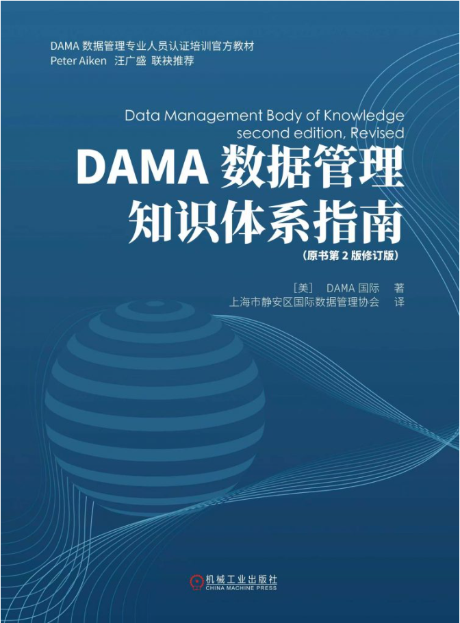

# DAMA
（可复制可搜索）修订_DAMA数据管理知识体系指南_OCR，DAMA网站推荐：https://www.mydama.org.cn/train/cdga/ ，这本书，原书第二版的；2025年4月出版的修订版（ISBN: 9787111778639）
CDGA 考试的题
DAMA-DMBOK: The DAMA Guide to the Data Management Body of Knowledge；
Learning notes, summaries, knowledge maps, and practical implementations of the DAMA Data Management Body of Knowledge.

我用夸克网盘给你分享了「（可复制可搜索）修订_DAMA数据管理知识体系指南_OCR(1).pdf」，点击链接或复制整段内容，打开「夸克APP」即可获取。 
## 链接：https://pan.quark.cn/s/7c5ac1963f6c
## 提取码：TG1M

# 本人高价买的文件；
# 如果对你有帮助可以打赏，谢谢！

  

## 认准图片：

 

